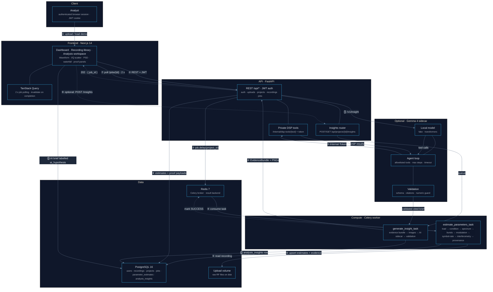
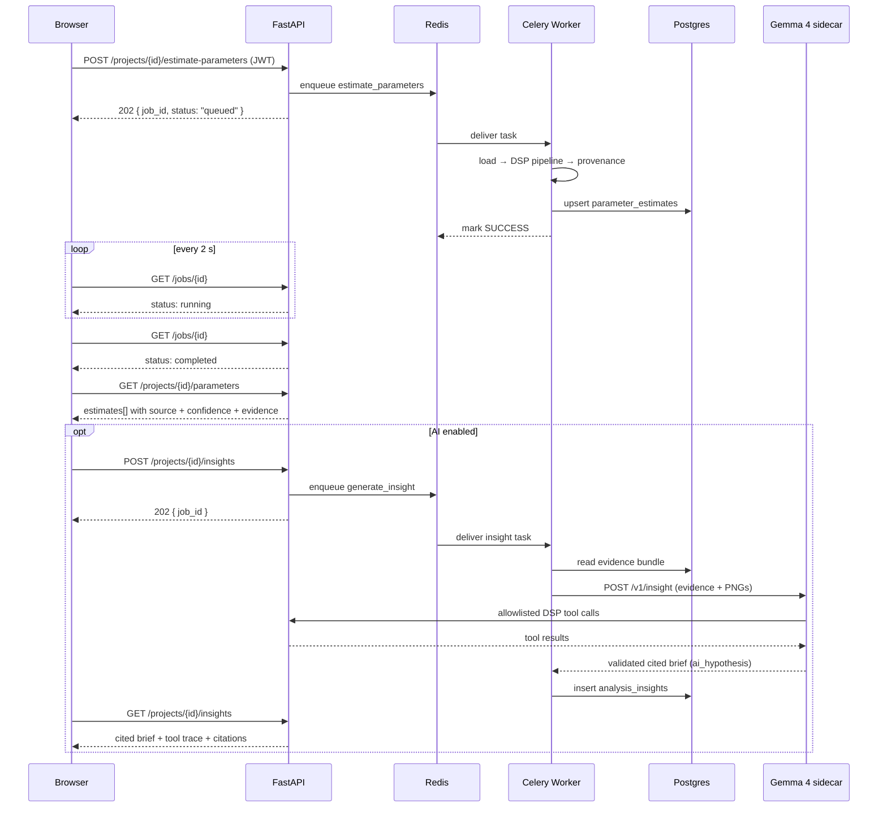

<div align="center">

# SignalScope AI — System Architecture

**How the frontend, API, Celery worker, DSP core, data stores, and optional Gemma 4 sidecar fit together.**

---


</div>

---

## System overview

SignalScope turns raw RF recordings into **explainable parameter estimates**.

The deterministic path is fully async: the browser uploads a recording, the API validates it with the same DSP loaders used by the worker, Celery runs the analysis pipeline in the background, and provenance rows land in PostgreSQL. The UI polls job status and refetches results when the job completes.

An optional Gemma 4 sidecar adds a cited analyst brief on top of the stored evidence. It is **not** part of the deterministic truth path: it reads evidence, calls allowlisted DSP tools, and returns `ai_hypothesis` output whose numbers are substituted by the backend.

---

## System design diagram



---

## Layer decomposition

### 1. Client layer

- Next.js 14 App Router SPA with JWT cookie authentication.
- TanStack Query owns server state. Parameter jobs poll every 2 s and insight jobs every 1.5 s while `queued`/`running`; results are invalidated when the job flips to `completed`.
- Plotly renders waveform, I/Q scatter, PSD, waterfall, constellation, proof spectra, and ranked candidate bars.
- `ProofPanel` drills into evidence inline on desktop and as a bottom sheet at ≤375 px.
- The UI is installable (web manifest + icons) and responsive.

### 2. Application layer (FastAPI)

- Auth with Argon2 password hashing and JWT in an httpOnly cookie (Bearer fallback for tooling).
- Uploads validated for format (`wav`, `raw_iq`, `sigmf`), size (200 MB cap), and content using the DSP loaders; files are streamed to disk with SHA-256 hashing and duplicate detection.
- `POST /api/projects/{id}/estimate-parameters` returns **202 Accepted** with a job id.
- Deep analysis runs synchronously over a bounded ROI window for interactive proof and FEC experiments.
- The optional `POST /api/projects/{id}/insights` route queues an AI brief and returns **202**; it returns **503** when `AI_ENABLED=false`.
- `/internal/dsp-tools/{tool_name}` is a private, shared-secret route used only by the AI sidecar. An empty `INTERNAL_API_TOKEN` disables it.

### 3. Compute layer (Celery worker)

- Consumes tasks from Redis db 1 and reports to Redis db 2.
- Runs `signalscope_dsp` — installed editable into both the worker and API so pre-checks and estimates cannot drift.
- `estimate_parameters_task`: full-recording analysis and provenance persistence.
- `generate_insight_task`: builds an evidence bundle, renders evidence images, calls the AI sidecar, validates the response, and stores `analysis_insights`.
- AI failure never destroys DSP results; the failure is stored with an error message for the UI.

### 4. DSP pipeline

```text
load → ROI crop → condition → PSD/waterfall → spectral features
     → burst detection → modulation classification
     → symbol-rate candidates → interferometric origin
     → demodulation → de-interleaving → FEC → bit correlation
     → provenance assembly
```

Every stage emits candidates with **evidence strings**. The final `Estimate` carries:

```json
{
  "name": "symbol_rate",
  "value": 250000.0,
  "unit": "symbols/s",
  "source": "estimated",
  "confidence": 0.93,
  "evidence": ["dominant spectral peak at 250.0 kHz ..."],
  "alternatives": [],
  "warnings": []
}
```

**Sources** — `metadata`, `user_supplied`, `measured`, `estimated`, `hypothesis`, `ai_hypothesis`, `unknown`.

**Interferometric origin** — when a raw-IQ recording contains simultaneous antenna channels (`channels >= 2`, interleaved `I0 Q0 I1 Q1 ...` frames), the worker correlates antennas and returns `sky`, `near_field_observatory`, or `inconclusive`. Coherence, phase-slope linearity, delay, and optional `baseline_m` bounds are included in the evidence.

### 5. AI layer (optional)

- `services/ai` is a separate FastAPI service on port `8100`, started with the `ai` Compose profile.
- Backends: deterministic `fake` (no model download) and `transformers` (local Gemma 4). Other local runtimes (GGUF/Ollama-class) can be added behind the same `InsightBackend` protocol.
- Default model: `google/gemma-4-E4B-it` (Apache-2.0).
- Rendered evidence images (PSD, waterfall, constellation, M-th power) are generated with Pillow and sent as bounded PNG data URIs; raw I/Q is never sent.
- The model may call only: `get_project_evidence`, `run_deep_analysis`, `try_demodulation`, `try_fec`.
- Tool count and duration are bounded by `AI_MAX_TOOL_STEPS` and `AI_TOOL_TIMEOUT_SECONDS`.
- Validation enforces strict JSON schema, evidence references, numeric substitution (`{{estimate:name}}`), and allowlisted tool traces. Failures retry once, then fall back safely.

### 6. Data layer

- **PostgreSQL 16** — users, recordings, metadata, projects, jobs, parameter estimates (`value_json` + `evidence_json`), and analysis insights (`response_json`, `tool_trace_json`, `citations_json`).
- **Redis db 0** — configured via `REDIS_URL` for app cache (currently unused).
- **Redis db 1** — Celery broker.
- **Redis db 2** — Celery result backend and job status.
- **Upload volume** — raw RF files on disk, referenced from the database and never held in memory beyond a bounded window.

---

## Request / lifecycle flow



---

## Local development topology

| Container | Image build | Port | Role |
|---|---|---|---|
| `web` | `docker/Dockerfile.web` | `3000` | Next.js standalone server |
| `api` | `docker/Dockerfile.api` | `8000` | FastAPI + `/docs` |
| `worker` | `docker/Dockerfile.worker` | — | Celery DSP/insight executor |
| `ai` (optional) | `services/ai/Dockerfile` | `8100` | Local Gemma 4 sidecar |
| `postgres` | `postgres:16-alpine` | `5432` | Primary datastore |
| `redis` | `redis:7-alpine` | `6379` | Broker + backend + cache |

> The dev overlay (`docker-compose.dev.yml`) adds hot-reload for API and worker. Run the web dev server on the host for frontend HMR. The AI service is opt-in via `docker compose --profile ai up`.

---

## Scaling and failure behavior

| Concern | Behavior |
|---|---|
| Large recordings | Uploads are streamed; interactive analysis reads a bounded window (200k samples); the worker processes the ROI with the full pipeline. |
| Worker down | Jobs remain queued; the UI keeps polling and surfaces the state instead of hanging. |
| AI down or invalid | DSP results are untouched; the insight row records the error and the UI shows an explicit fallback. |
| Cross-user access | Every project, recording, job, and insight route checks ownership. |
| Rate limiting | In-process fixed-window limits per client IP: login 10/min, upload 30/min. |
| Secrets | `SECRET_KEY` must be overridden; `INTERNAL_API_TOKEN` gates the private DSP tool route. |
| AI numeric honesty | Numbers in the brief are backend-substituted from provenance; the model never writes authoritative values. |

---

<div align="center">

**_"Every number is an estimate. Every estimate has a source, a confidence, and evidence you can read."_**

[← Back to README](./README.md)

</div>
