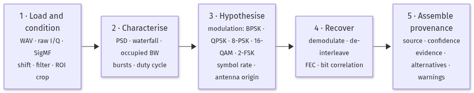
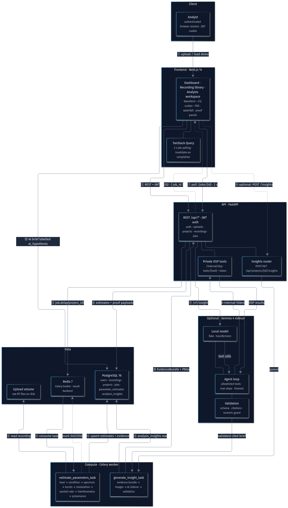

# SignalScope AI

**An offline, explainable RF signal-analysis workbench for authorized recordings.**

Repository: https://github.com/Manas-Dikshit/SignalScope
Docs: https://github.com/Manas-Dikshit/SignalScope/blob/main/README.md
Full description: https://github.com/Manas-Dikshit/SignalScope/blob/main/PROJECT_DESCRIPTION.md

> Built for **authorized** spectrum analysis only. No decryption, no live SDR
> capture, no direction-finding product.

---

## The problem

Most RF tools print one number — `QPSK`, `2400 baud` — with no confidence, no
alternatives, and no indication of how the value was produced. Operators end up
treating a guess as a measurement. The rest of the workflow (spectrum, bursts,
demodulation, de-interleaving, FEC, correlation) lives in separate tools with
incompatible outputs.

## The solution

SignalScope runs the whole chain in one workbench and keeps the reasoning
attached to every result. Every value is an **estimate** with a `source`, a
`confidence` in `[0, 1]`, readable `evidence`, competing `alternatives`, and
explicit `warnings`.



Pipeline: https://github.com/Manas-Dikshit/SignalScope/blob/main/docs/diagrams/pipeline.png

The UI exposes a **View proof** panel, so a user can inspect the actual spectrum
peak, symbol-clock line, run-length histogram, or FEC detail behind any claim.
The system is useful when it succeeds **and** honest when it cannot.

---

## What it does

- **Ingest** — WAV (mono/stereo I/Q), raw I/Q (`int8`…`float64`, endianness,
  interleaved/separate/real-only), SigMF, plus a built-in synthetic generator.
  Uploads are streamed, SHA-256 hashed, deduplicated, and capped at 200 MB.
- **Characterise** — PSD, waterfall, occupied bandwidth, peak/centroid
  frequency, spectral flatness, crest factor, zero-crossing rate, SNR estimate,
  drift rate, burst segments and duty cycle.
- **Hypothesise** — BPSK, QPSK, 8-PSK, 16-QAM and 2-FSK with ranked
  alternatives and M-th-power proof spectra; symbol-rate candidates with a
  symbol-clock proof; antenna origin (`sky`, `near_field_observatory`,
  `inconclusive`) from cross-spectral coherence and phase-slope delay.
- **Recover** — PSK/QAM/FSK demodulation, block/convolutional/diagonal/
  pseudo-random de-interleaving candidates, convolutional/Viterbi,
  Reed–Solomon with erasures, LDPC min-sum, concatenated RS + convolutional,
  CRC-16/CCITT validation, and repeated-sequence bit correlation.
- **Report** — one JSON-serializable report assembling estimates, artifacts,
  and warnings, exportable for reproducibility.



Architecture diagram: https://github.com/Manas-Dikshit/SignalScope/blob/main/docs/diagrams/architecture.png

---

## How it is built

- **Frontend** — Next.js 14 App Router, React 18, TypeScript, Tailwind,
  shadcn/ui, TanStack Query (2 s job polling), Zustand, Plotly.js.
- **API** — FastAPI, Pydantic v2, SQLAlchemy 2.0 async, Alembic, JWT in an
  httpOnly cookie, Argon2 hashing, per-IP rate limits, ownership checks on
  every route.
- **Compute** — Celery 5.5 over Redis 7; the worker is the only process that
  reads recordings from the uploads volume and runs the DSP pipeline.
- **Data** — PostgreSQL 16 as the single source of truth for estimates,
  evidence, jobs, and insights.
- **DSP** — Python 3.11–3.13, NumPy 2.2, SciPy 1.15, Pillow for evidence PNGs.
- **AI (optional)** — local Gemma 4 E4B via Transformers, or a deterministic
  fake backend for tests and offline demos.
- **Runtime** — Docker Compose (base + dev overlay, optional `ai` profile).

The browser talks only to FastAPI. FastAPI enqueues Celery jobs through Redis
and returns `202` with a job id; the UI polls `/api/jobs/{id}` and refetches the
persisted estimates when the job completes. No analysis result is held only in
memory.

---

## The optional AI analyst

The AI layer is **off by default** (`AI_ENABLED=false`); the deterministic
product is complete without it. When enabled, a local Gemma 4 sidecar reads a
structured evidence bundle, reviews rendered evidence images (never raw I/Q),
calls only allowlisted DSP tools through a token-gated private route, and
returns a cited brief.

Guardrails: output is stored as `ai_hypothesis`; strict JSON schema; citations
must resolve to the supplied bundle; the model writes `{{estimate:name}}`
placeholders and the backend substitutes authoritative values; tool steps,
timeouts, and image sizes are capped; DSP results are preserved if the model
fails.

---

## Testing

165 tests: DSP core 69, API 51, AI sidecar 19, frontend 26. Coverage includes
loading, bounded windows, dual-antenna origin verdicts, modulation/demodulation
round trips, symbol-rate proofs, de-interleaving, FEC with CRC validation,
auth and cross-user isolation, and AI validation and tool-loop limits.

## Limitations

No live RF capture, no geolocation, no decryption. Demodulators sample symbol
centres directly (no closed-loop Costas/PLL or Gardner/M&M yet). FEC defaults to
hard-decision Viterbi; LDPC accepts soft LLRs. Interferometric delay resolves
only within half the analyzed band. The interactive deep-analysis endpoint
analyses a capped window; the full-file Celery job remains authoritative.

## Try it

```bash
git clone https://github.com/Manas-Dikshit/SignalScope.git signalscope
cd signalscope
cp .env.example .env
cp apps/web/.env.example apps/web/.env.local
openssl rand -hex 32   # set as SECRET_KEY in .env
docker compose -f docker-compose.yml -f docker-compose.dev.yml up --build
```

Open `http://localhost:3000`, register, then load a demo signal or upload a
recording. Five synthetic demos (QPSK, 2-FSK, 16-QAM, BPSK bursts, 8-PSK) make
the whole pipeline demonstrable with no external dataset.

## Generative AI disclosure

- **Coding assistants:** Kimi K2 Thinking, DeepSeek V3.2, Gemini 3.5 Flash
  Lite, Claude Sonnet 5.5, and OpenCode, used for implementation, tests, and
  documentation. All code was reviewed and run by the team.
- **Runtime model:** the optional analyst is `google/gemma-4-E4B-it`
  (Apache-2.0), run locally. It never produces authoritative numbers and never
  receives raw I/Q.

## License

MIT. Gemma 4 weights are distributed by Google under Apache-2.0.
