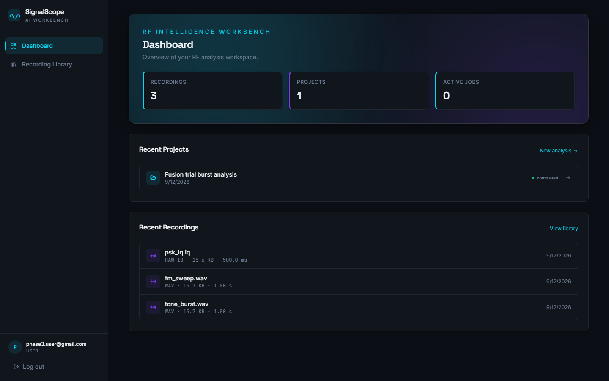
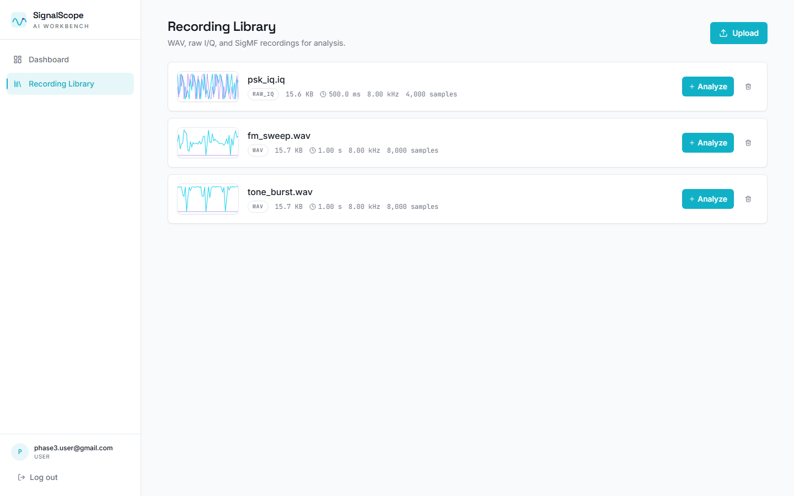
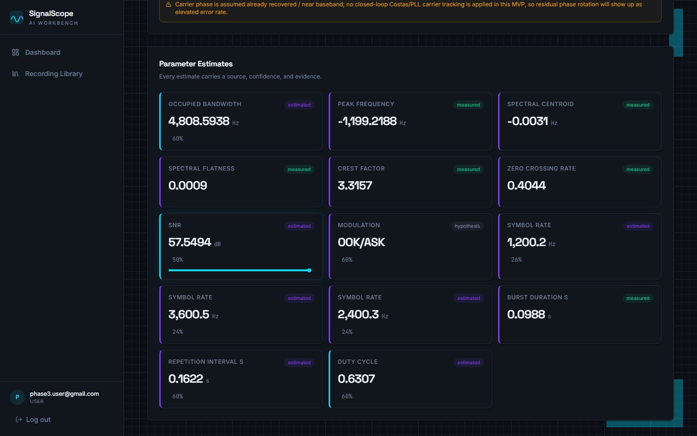
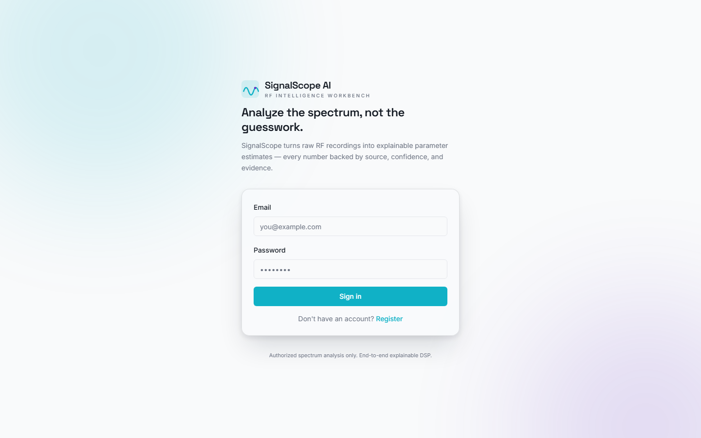

# SignalScope AI — Project Description

**An offline, explainable RF signal-analysis workbench for authorized recordings.**

Version 0.1.0 · MIT License · Deterministic DSP core · Optional local Gemma 4 analyst

**Repository:** https://github.com/Manas-Dikshit/SignalScope

**Documentation:** [README](https://github.com/Manas-Dikshit/SignalScope/blob/main/README.md) · [Architecture](https://github.com/Manas-Dikshit/SignalScope/blob/main/ARCHITECTURE.md) · [Run guide](https://github.com/Manas-Dikshit/SignalScope/blob/main/RUN.md) · [Local setup](https://github.com/Manas-Dikshit/SignalScope/blob/main/docs/LOCAL_SETUP.md) · [Traceability](https://github.com/Manas-Dikshit/SignalScope/blob/main/docs/REQUIREMENTS_TRACEABILITY.md)

---

> [!IMPORTANT]
> SignalScope is built for **authorized** spectrum analysis. Use it only on
> recordings you own or have explicit permission to analyze. It does not
> decrypt protected communications and it is not a live SDR capture system.

---

## 1. Executive summary

SignalScope AI turns WAV, raw I/Q, and SigMF recordings into a complete,
provenance-tracked picture of a signal: spectrum, bursts, modulation,
symbol rate, antenna origin, demodulated bits, de-interleaving structure,
FEC decoding, and bit-stream correlation.

The project exists to fix a specific failure mode in RF tooling: most
analyzers return a single number with no indication of how it was produced or
how much to trust it. SignalScope treats **every value as an estimate** and
ships it with:

- a `source` (`metadata`, `user_supplied`, `measured`, `estimated`,
  `hypothesis`, `ai_hypothesis`, `unknown`);
- a `confidence` in `[0, 1]`;
- readable `evidence` strings;
- competing `alternatives` where they exist;
- explicit `warnings` when the method has limits.

The deterministic pipeline runs fully offline. An optional Gemma 4 sidecar adds
a cited natural-language analyst brief on top of the stored evidence, but it is
never allowed to replace measured values or invent numbers.

**One-line pitch:** an RF workbench that shows its work.

---

## 2. The problem

RF analysis is hard for three reasons:

1. **Signals are incomplete by nature.** A recording gives you samples, not
   ground truth. Modulation, symbol rate, coding, and origin are inferred.
2. **Most tools hide uncertainty.** A classifier prints `QPSK` with no
   confidence, no alternatives, and no indication that it might be wrong.
   Operators then treat a guess as a measurement.
3. **The full workflow is fragmented.** Spectrum inspection, burst detection,
   demodulation, de-interleaving, FEC, and correlation usually live in
   different tools with incompatible outputs.

For learning, research, and authorized spectrum work, that combination is
dangerous: it is easy to over-trust a result that was never verified.

---

## 3. The solution

SignalScope is a single workbench that runs the whole chain and keeps the
reasoning attached to every result:

```text
load → condition → spectrum → bursts → modulation → symbol rate
     → interferometric origin → demodulation → de-interleave → FEC
     → bit correlation → provenance assembly
```

Every stage produces structured evidence. The API persists it. The UI exposes
it. A user can open **View proof** and inspect the actual spectrum peak,
symbol-clock line, run-length histogram, or FEC detail behind a claim.

The result is a system that is useful when it succeeds **and** honest when it
cannot.

---

## 4. Who it is for

| User | What they get |
|---|---|
| RF / DSP students | A readable end-to-end chain with evidence for every stage |
| Researchers | Reproducible, local analysis of authorized captures with JSON export |
| Spectrum analysts | Burst, modulation, symbol-rate, coding, and origin hypotheses in one place |
| Protocol reverse-engineering learners | Demodulation, de-interleaving candidates, FEC experiments, and bit correlation |
| Evaluators and judges | A complete, test-covered system that demonstrates honest uncertainty handling |

It is **not** a live receiver, a decryption tool, or a direction-finding
product.

---

## 5. Design principles

| Principle | Implementation |
|---|---|
| **Never fake success** | Stages fail loudly or return `unknown`; they do not fabricate values |
| **Provenance first** | Every estimate is an object, not a bare number |
| **Offline and private** | The DSP core, API, worker, and UI run locally; recordings never leave the machine |
| **Evidence drill-down** | Proof payloads are produced by DSP internals and rendered in the UI |
| **Reproducibility** | Synthetic generator, committed samples, demo catalog, deterministic fake AI backend |
| **Optional AI, never authoritative** | AI output is labelled `ai_hypothesis`; numbers are backend-substituted |
| **Bounded work** | Uploads streamed, interactive analysis windowed, tool loop capped, images capped |

---

## 6. Capabilities

### 6.1 Ingestion

| Format | Details |
|---|---|
| **WAV** | Mono or stereo I/Q; stereo modes `left_is_i_right_is_q`, `left_only`, `right_only`, `mono_mix` |
| **Raw I/Q** | `int8`, `uint8`, `int16`, `uint16`, `int32`, `float32`, `float64`; little/big endian; `interleaved`, `separate_iq`, `real_only`; optional sample rate, center frequency, channels, baseline |
| **SigMF** | Paired `-meta` + `-data` files, including standard metadata fields |
| **Synthetic** | Built-in generator for BPSK, QPSK, 8-PSK, 16-QAM, 2-FSK, with configurable SNR, symbol rate, carrier offset, and burst patterns |

Uploads are streamed to disk, SHA-256 hashed, deduplicated per user, validated
with the same DSP loaders used by the worker, and capped at 200 MB.

### 6.2 Signal analysis

| Area | Outputs |
|---|---|
| **Conditioning** | Frequency shift, filtering/conditioning configuration, bounded ROI crops |
| **Spectrum** | PSD, waterfall, occupied bandwidth, peak frequency, centroid frequency |
| **Spectral features** | Flatness, crest factor, zero-crossing rate, SNR estimate, frequency drift rate |
| **Bursts** | Burst segments, durations, duty cycle, inter-burst statistics, alternatives |
| **Modulation** | BPSK, QPSK, 8-PSK, 16-QAM, 2-FSK hypotheses with ranked alternatives and M-th-power proof spectra |
| **Symbol rate** | Multiple candidates with a symbol-clock spectrum proof |
| **Antenna origin** | `sky`, `near_field_observatory`, or `inconclusive` from cross-spectral coherence and phase-slope delay |
| **Demodulation** | PSK, QAM, and FSK bit streams; hard bits plus a soft-magnitude proxy |
| **De-interleaving** | Block, convolutional, diagonal, and pseudo-random candidates scored by run-length structure |
| **FEC** | Rate-1/2 convolutional/Viterbi, Reed–Solomon with erasures, LDPC min-sum belief propagation, concatenated RS + convolutional, CRC-16/CCITT validation |
| **Correlation** | Repeated-sequence detection and bit-stream correlation |
| **Reporting** | One JSON-serializable report assembling estimates, artifacts, and warnings |

### 6.3 Interactive deep analysis

The project workspace exposes a synchronous deep dive over a bounded ROI
window (first ~0.2 M samples) so the UI stays responsive:

- PSD and waterfall over the selected region
- spectral features
- modulation hypothesis with proof spectra
- symbol-rate candidates with the symbol-clock line
- demodulated bits and constellation
- de-interleaving candidates with run-length histograms
- selectable FEC decoding with corrected-symbol and CRC detail
- repeated-sequence correlation

The full-file Celery job remains the authoritative analysis; the interactive
endpoint is deliberately capped and labelled as such.

### 6.4 Demo signal lab

Five synthetic recordings load instantly from the dashboard or recording
library:

| Demo | Modulation | Sample rate | Symbol rate |
|---|---|---:|---:|
| QPSK carrier | QPSK | 48 kHz | 2400 baud |
| Binary FSK | 2-FSK | 48 kHz | 1200 baud |
| 16-QAM grid | 16-QAM | 48 kHz | 2400 baud |
| BPSK bursts | BPSK | 48 kHz | 2400 baud |
| 8-PSK circular | 8-PSK | 48 kHz | 2400 baud |

This makes the entire pipeline demonstrable with no external dataset.

---

## 7. Analysis workflow

### 7.1 Asynchronous full analysis

```text
 1. Browser  -> FastAPI : POST /api/projects/{id}/estimate-parameters
 2. FastAPI  -> Redis   : enqueue estimate_parameters
 3. FastAPI  -> Browser : 202 { job_id, status: "queued" }
 4. Redis    -> Worker  : deliver task
 5. Worker   -> Volume  : read recording
 6. Worker   -> Worker  : run signalscope_dsp pipeline
 7. Worker   -> Postgres: upsert parameter_estimates (+ evidence)
 8. Worker   -> Redis   : mark SUCCESS
 9. Browser  -> FastAPI : GET /api/jobs/{id}  (poll every 2 s)
10. FastAPI  -> Browser : running / completed
11. Browser  -> FastAPI : GET /api/projects/{id}/parameters
12. FastAPI  -> Browser : estimates with source, confidence, evidence,
                          alternatives
```

**Read as:** the browser asks FastAPI for an estimate, FastAPI enqueues a Celery
tasks through Redis and returns `202` with a job id. The worker reads the
recording, runs the DSP pipeline, persists estimates and evidence in
PostgreSQL, then marks the job successful. The browser polls the job, refetches
when it completes, and renders the persisted estimates. No analysis result is
held only in memory.

### 7.2 Interactive workspace

The workspace lets the user select an ROI and inspect results immediately:
waveform, I/Q scatter, PSD, waterfall, burst timeline, ranked candidates,
proof panels, and deep-analysis tabs. It is intentionally a separate path from
the full job so interactive latency never compromises the authoritative run.

---

## 8. Provenance and uncertainty model

Every estimate is an object:

```json
{
  "name": "symbol_rate",
  "value": 250000.0,
  "unit": "symbols/s",
  "source": "estimated",
  "confidence": 0.93,
  "evidence": [
    "dominant spectral peak at 250.0 kHz (±2.5 kHz) in the cyclostationary profile",
    "agrees within 1.2% of candidate from zero-crossing analysis"
  ],
  "alternatives": [
    {
      "name": "symbol_rate",
      "value": 256000.0,
      "unit": "symbols/s",
      "source": "hypothesis",
      "confidence": 0.41,
      "evidence": ["second harmonic candidate"]
    }
  ],
  "warnings": []
}
```

### 8.1 Source taxonomy

| Source | Meaning |
|---|---|
| `metadata` | Read from a file header or SigMF sidecar |
| `user_supplied` | Entered explicitly by the operator |
| `measured` | Deterministic from the data (for example, duration = samples / rate) |
| `estimated` | Inferred by an algorithm, with uncertainty |
| `hypothesis` | One of several competing explanations |
| `ai_hypothesis` | Generated by a model; never authoritative |
| `unknown` | Not available and not estimated |

### 8.2 Confidence and evidence in the UI

The frontend colour-codes confidence, renders evidence inline, and provides a
`ProofPanel` for deeper inspection. Proof payloads are generated by the DSP
modules that produced the estimate — not re-derived in the UI or API. On small
screens the proof panel becomes a bottom sheet.

---

## 9. Interferometric origin

Given a raw-IQ recording with simultaneous antenna channels (`channels >= 2`,
interleaved `I0 Q0 I1 Q1 …` frames), SignalScope correlates the antennas and
answers one narrow question:

- **`sky`** — the signal follows a single propagation-consistent path;
- **`near_field_observatory`** — reflections, excess delay, or incoherent
  phase indicate a local source;
- **`inconclusive`** — the antennas do not share enough signal to decide.

The method measures cross-spectral coherence and fits the cross-spectrum phase
slope to estimate delay. A user-supplied `baseline_m` enables a far-field
propagation bound and a sky bearing estimate. The delay is resolvable only
within half the analyzed band, so wider delays can alias. This is a
classification with evidence — not a direction-finding product.

---

## 10. Optional Gemma 4 AI analyst

The AI layer is **off by default** (`AI_ENABLED=false`). The deterministic
product is complete without it.

```text
Stored DSP evidence
        |
        v
  EvidenceBundle
    |       |
    |       +--> Rendered PNGs (PSD, waterfall, constellation, M-th power)
    |                     |
    v                     v
Gemma 4 sidecar <---------+
    |
    +--> Allowlisted DSP tools
    |         |
    |         v
    |    Private API route (X-Internal-Token)
    |         |
    |         +--> back to the sidecar
    |
    +--> Schema + citation + numeric validation
                |
                v
      Cited brief, source = ai_hypothesis
```

### 10.1 What it does

- Reads a structured evidence bundle built from stored estimates.
- Reviews rendered evidence images; **raw I/Q is never sent to the model**.
- Calls only allowlisted tools:
  - `get_project_evidence`
  - `run_deep_analysis`
  - `try_demodulation`
  - `try_fec`
  - `search_similar_recordings`
- Reports conflicts, anomalies, unknowns, limitations, and recommended next
  actions.
- Produces a brief whose numeric values are substituted by the backend from
  provenance.

### 10.2 Guardrails

| Guardrail | Detail |
|---|---|
| **Provenance** | Output is stored and displayed as `ai_hypothesis` |
| **Schema** | Strict JSON validation before the response leaves the sidecar |
| **Citations** | Evidence references must resolve to the supplied bundle |
| **Numeric guard** | The model writes `{{estimate:name}}` placeholders; the backend substitutes authoritative values |
| **Tool allowlist** | Fixed handler map behind a token-gated private route; the model cannot choose a URL or execute code |
| **Bounds** | `AI_MAX_TOOL_STEPS` (default 6), `AI_TOOL_TIMEOUT_SECONDS` (30), `AI_TIMEOUT_SECONDS` (120) |
| **Images** | Per-image 300 KB cap, 1 MB bundle cap, SHA-256 audit of every image sent |
| **Failure** | DSP results are preserved; the insight row records the error and the UI shows a fallback |

### 10.3 Backends

- `fake` — deterministic, no weights, used for tests and offline demos;
- `transformers` — local Gemma 4 (`google/gemma-4-E4B-it`, Apache-2.0), loaded
  lazily so tests never import torch.

Other local runtimes can be added behind the same `InsightBackend` protocol.

---

## 11. System architecture

```text
Client
  Browser: Next.js 14 App Router UI
    Dashboard - Recording library - Analysis workspace
    TanStack Query: job polling + cache
        |
        | REST (JWT)
        v
FastAPI
  REST API: auth - uploads - recordings - projects - jobs
  Private DSP tools route (X-Internal-Token)
  Evidence image renderer
        |
        +--> Redis 7: Celery broker + result backend
        |         |
        |         v
        |    Celery worker
        |      estimate_parameters_task
        |      generate_insight_task
        |      signalscope_dsp: loaders - DSP stages - FEC - provenance
        |         |
        |         +--> uploads volume: WAV / raw I/Q / SigMF recordings
        |
        +--> PostgreSQL 16: projects - recordings - jobs - estimates -
        |      evidence - insights
        |
        +--> Optional Gemma 4 sidecar
               fake or transformers backend
               agent loop + validation
```

The browser talks only to FastAPI. FastAPI hands long-running work to Celery
through Redis, and the worker is the only process that reads recordings from the
uploads volume and runs the DSP pipeline. PostgreSQL is the single source of
truth for results. The Gemma 4 sidecar is optional and reached only through
FastAPI's token-gated private route.

### 11.1 Components

| Component | Responsibility |
|---|---|
| `apps/web` | Next.js App Router UI: dashboard, recording library, analysis workspace, proof panels, deep-analysis tabs, AI brief |
| `services/api` | FastAPI gateway: auth, uploads, recordings, projects, jobs, insights, dashboard, private DSP tool route |
| `services/dsp-worker` | `signalscope_dsp` library: loaders, conditioning, spectrum, bursts, modulation, symbol rate, interferometry, demodulation, interleaving, FEC, correlation, reporting, synthetic generator |
| `services/ai` | Optional FastAPI sidecar: evidence bundle, model backends, allowlisted tool loop, validation |
| `postgres` | Users, recordings, metadata, projects, jobs, estimates, insights |
| `redis` | Celery broker (db 1), result backend (db 2), configured app cache (db 0) |
| `uploads_data` | Raw RF files on disk, never loaded whole into memory |
| `streamlit_prototype` | Lean standalone DSP/UI prototype kept for reference |

### 11.2 Data model

| Table | Contents |
|---|---|
| `users` | Account identity, password hash, role, timestamps |
| `recordings` | Original filename, storage path, SHA-256, size, format, owner, status |
| `recording_metadata` | Sample rate, center frequency, dtype, layout, endianness, channels, complex flag, metadata source/confidence |
| `analysis_projects` | Project name, description, recording reference, owner, selected ROI sample range |
| `parameter_estimates` | Parameter name, JSON value, value type, confidence, evidence JSON, source |
| `analysis_insights` | Model, prompt version, status, response/tool-trace/citations JSON, error message |
| `artifacts` | Generated artifact metadata and hashes |

---

## 12. API surface

Full interactive documentation is served at `/docs`.

| Area | Endpoints | Methods |
|---|---|---|
| Auth | `/api/auth/register`, `/login`, `/logout`, `/me` | POST, POST, POST, GET |
| Uploads | `/api/recordings/upload` | POST |
| Recordings | `/api/recordings`, `/{id}`, `/{id}/metadata`, `/{id}/preview` | GET; GET/PATCH/DELETE; GET/PATCH; GET |
| Demo signals | `/api/recordings/demos`, `/api/recordings/load-demo` | GET, POST |
| Projects | `/api/projects`, `/{id}` | POST/GET; GET/PATCH/DELETE |
| Analysis | `/api/projects/{id}/estimate-parameters` | POST → 202 |
| Results | `/api/projects/{id}/parameters`, `/{id}/analysis`, `/{id}/segments` | GET |
| Bursts | `/api/projects/{id}/detect-bursts` | POST |
| AI insights | `/api/projects/{id}/insights` | POST (queue), GET (latest) |
| Jobs | `/api/jobs/{id}` | GET |
| Dashboard | `/api/dashboard/stats` | GET |
| Internal DSP tools | `/internal/dsp-tools/{tool_name}` | POST + `X-Internal-Token` |
| Health | `/health` | GET |

Authentication uses Argon2 password hashing and a JWT in an httpOnly cookie
(with a Bearer fallback for tooling). Ownership checks apply to every project,
recording, job, and insight route. The private DSP tool route is disabled when
`INTERNAL_API_TOKEN` is empty.

---

## 13. Frontend experience

- **Dashboard** — library overview, recent projects, usage stats, demo signal
  shortcuts, and a cinematic signal background.
- **Recording library** — upload wizard, format-specific parameter forms,
  waveform thumbnails, demo catalog, metadata editing, duplicate handling.
- **Analysis workspace** — waveform and I/Q scatter with ROI selection, PSD,
  waterfall, burst timeline, ranked modulation/symbol-rate candidates,
  confidence badges, and downloadable proof JSON.
- **Deep analysis tabs** — demodulated bits, constellation, de-interleaving
  candidates, FEC selection, and correlation.
- **ProofPanel** — inline evidence on desktop, bottom sheet at ≤375 px.
- **InsightPanel** — AI brief with `ai_hypothesis` badge, citations, tool trace,
  and explicit error/fallback states.
- **App shell** — web manifest, favicons, responsive layout.

### 13.1 Screenshots

Images use absolute URLs so they render outside GitHub. Each caption also links
to the file in the repository, in case the renderer blocks remote images.

**Dashboard**



[Open dashboard screenshot](https://github.com/Manas-Dikshit/SignalScope/blob/main/docs/screenshots/after/dashboard.1440.after.png)

**Recording library**



[Open recording library screenshot](https://github.com/Manas-Dikshit/SignalScope/blob/main/docs/screenshots/after/recordings.1440.after.png)

**Analysis workspace**



[Open analysis workspace screenshot](https://github.com/Manas-Dikshit/SignalScope/blob/main/docs/screenshots/after/workspace.1440.after.png)

**Landing page**



[Open landing page screenshot](https://github.com/Manas-Dikshit/SignalScope/blob/main/docs/screenshots/after/landing.1440.after.png)

---

## 14. Technology stack

| Layer | Technology |
|---|---|
| Frontend | Next.js 14.2, React 18.3, TypeScript 5.6, Tailwind CSS 3.4, shadcn/ui, TanStack Query 5, Zustand, Plotly.js |
| Backend | FastAPI 0.115, Pydantic v2, SQLAlchemy 2.0 async, Alembic, Celery 5.5, python-jose, passlib/Argon2 |
| Data | PostgreSQL 16, Redis 7, Docker volumes |
| DSP | Python 3.11–3.13, NumPy 2.2, SciPy 1.15, Pillow (evidence PNGs) |
| AI | Gemma 4 E4B via Transformers (Apache-2.0), deterministic fake backend |
| Testing | Pytest, pytest-asyncio, httpx, Vitest, Testing Library |
| Runtime | Docker Compose (base + dev overlay, optional `ai` profile) |

---

## 15. Reliability and bounded work

| Concern | Behavior |
|---|---|
| **Large recordings** | Uploads stream to disk with hashing; interactive analysis reads a bounded window |
| **Long analysis** | Celery job with stage progress; UI polls until completion |
| **Worker down** | Jobs remain queued; the UI surfaces state instead of hanging |
| **AI down or invalid** | DSP results untouched; insight failure stored with error; UI fallback |
| **Cross-user access** | Ownership enforced on every project, recording, job, and insight route |
| **Rate limits** | In-process fixed-window limits per client IP: login 10/min, upload 30/min |
| **Secrets** | `SECRET_KEY` must be overridden; `INTERNAL_API_TOKEN` gates the private tool route |
| **Numeric honesty** | AI numbers are backend-substituted; measured values keep their source |

---

## 16. Security, privacy, and ethics

- **Local by default.** No cloud calls in the deterministic path.
- **No decryption.** The system analyzes signals; it does not break protected
  communications.
- **Authorization required.** The project is scoped to recordings the user owns
  or is permitted to analyze.
- **No live capture.** There is no SDR streaming or transmit capability.
- **No direction finding product.** Interferometry answers sky vs local with
  an estimate, not an operational bearing.
- **Auditable AI.** The model receives bounded evidence, never raw IQ; its
  output is labelled and citation-checked.

---

## 17. Testing and verification

| Suite | Tests | Command |
|---|---:|---|
| DSP core | 74 | `cd services/dsp-worker && python -m pytest tests/ -q` |
| API | 63 | `cd services/api && python -m pytest tests/ -q` |
| AI sidecar | 22 | `cd services/ai && python -m pytest tests/ -q` |
| Frontend | 29 | `cd apps/web && npm test` |
| **Total** | **188** | |

Coverage includes:

- WAV, raw-IQ, and SigMF loading; bounded windows; dual-antenna frames
- interferometric sky/near-field/inconclusive verdicts
- modulation/demodulation BER round trips
- symbol-rate estimation and proof spectra
- block/convolutional/diagonal/pseudo-random de-interleaving
- convolutional, Reed–Solomon, LDPC, and concatenated FEC; CRC validation
- kHz–GHz band coverage and frequency drift
- auth, uploads, projects, jobs, and cross-user isolation
- demo samples and evidence-image caps
- AI validation, low-confidence tool follow-ups, max-step/timeout handling
- provenance badges and formatting utilities

The API suite runs against SQLite for speed; the PostgreSQL path is exercised by
Docker deployment. A known pre-existing TypeScript test-file matcher error is
documented in `CONTRIBUTING.md`.

---

## 18. Limitations and non-goals

- No live RF capture or SDR streaming.
- No geolocation or operational direction finding.
- No decryption of protected communications.
- Demodulators sample symbol centers directly; no closed-loop Costas/PLL or
  Gardner/M&M timing recovery yet.
- FEC defaults to hard-decision Viterbi; soft-decision Viterbi is future work.
  LDPC accepts soft LLRs.
- Interferometric delay is resolvable only within half the analyzed band.
- API tests use SQLite; the Postgres path is covered by deployment.
- The AI analyst is optional, local, and subordinate to deterministic DSP.
- The interactive deep-analysis endpoint analyzes a capped window, not the
  whole file.

---

## 19. Roadmap

- [x] Provenance-tracked DSP pipeline and evidence drill-down
- [x] WAV / raw-IQ / SigMF ingestion with bounded-window loading
- [x] Convolutional, Reed–Solomon, LDPC, and concatenated FEC
- [x] Burst detection, de-interleaving candidates, bit correlation
- [x] Interferometric origin discrimination from dual-antenna IQ
- [x] Demo signal library and app-shell UI
- [x] Gemma 4 cited brief, agent tool loop, multimodal evidence images
- [x] Rare-signal gallery / fingerprint similarity search
- [ ] QLoRA fine-tuning on synthetic RF evidence pairs
- [ ] Closed-loop carrier and timing recovery (Costas / PLL / Gardner)
- [ ] Neural-network modulation classifier
- [ ] Hardened multi-user deployment (key rotation, external object storage)
- [ ] GNU Radio integration

---

## 20. Quick start

```bash
git clone https://github.com/Manas-Dikshit/SignalScope.git signalscope
cd signalscope

cp .env.example .env
cp apps/web/.env.example apps/web/.env.local

# Set SECRET_KEY in .env to a real random value
openssl rand -hex 32

# Development stack (API/worker hot-reload)
docker compose -f docker-compose.yml -f docker-compose.dev.yml up --build
```

Open `http://localhost:3000`, register an account, then load a demo signal or
upload a recording. API documentation is at `http://localhost:8000/docs`.

For the optional AI analyst:

```bash
docker compose --profile ai up --build
```

See [`RUN.md`](https://github.com/Manas-Dikshit/SignalScope/blob/main/RUN.md) and [`docs/LOCAL_SETUP.md`](https://github.com/Manas-Dikshit/SignalScope/blob/main/docs/LOCAL_SETUP.md) for
native setup, configuration, and troubleshooting.

---

## 21. Documentation map

| Document | Purpose |
|---|---|
| [`README.md`](https://github.com/Manas-Dikshit/SignalScope/blob/main/README.md) | Overview, screenshots, quick start, API, testing |
| [`RUN.md`](https://github.com/Manas-Dikshit/SignalScope/blob/main/RUN.md) | Run modes, test suites, smoke test, troubleshooting |
| [`ARCHITECTURE.md`](https://github.com/Manas-Dikshit/SignalScope/blob/main/ARCHITECTURE.md) | System design, layers, sequence flow, deployment |
| [`detailedarch.md`](https://github.com/Manas-Dikshit/SignalScope/blob/main/detailedarch.md) | Low-level topology, stage contracts, AI contract |
| [`docs/LOCAL_SETUP.md`](https://github.com/Manas-Dikshit/SignalScope/blob/main/docs/LOCAL_SETUP.md) | Local Docker/native setup and configuration |
| [`docs/REQUIREMENTS_TRACEABILITY.md`](https://github.com/Manas-Dikshit/SignalScope/blob/main/docs/REQUIREMENTS_TRACEABILITY.md) | Requirement → implementation → test mapping |
| [`docs/GEMMA4_IMPLEMENTATION_PLAN.md`](https://github.com/Manas-Dikshit/SignalScope/blob/main/docs/GEMMA4_IMPLEMENTATION_PLAN.md) | Gemma 4 phases, contracts, guardrails, demo script |
| [`docs/DESIGN_NOTES.md`](https://github.com/Manas-Dikshit/SignalScope/blob/main/docs/DESIGN_NOTES.md) | UI visual-depth rationale |
| [`CONTRIBUTING.md`](https://github.com/Manas-Dikshit/SignalScope/blob/main/CONTRIBUTING.md) | Layout, conventions, tests, PR checklist |
| [`REFERENCES.md`](https://github.com/Manas-Dikshit/SignalScope/blob/main/REFERENCES.md) | Formats, DSP, FEC, interferometry, AI references |

---

## 22. License

MIT — see [`LICENSE`](https://github.com/Manas-Dikshit/SignalScope/blob/main/LICENSE). Gemma 4 model weights are distributed under
the Apache-2.0 license by Google.

**Every number is an estimate. Every estimate has a source, a confidence, and evidence you can read.**
