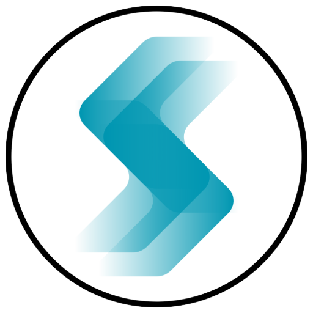
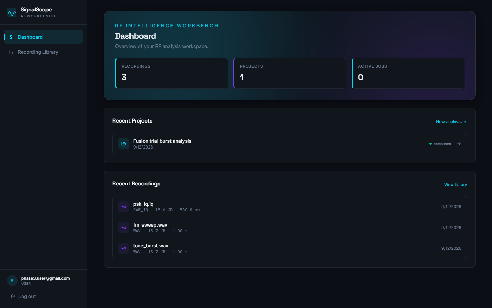
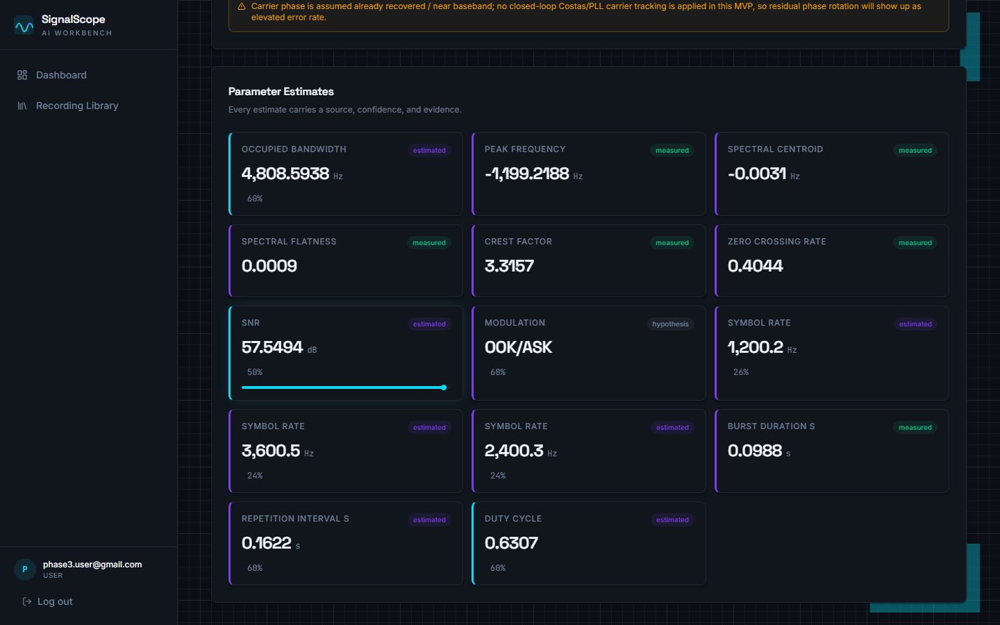
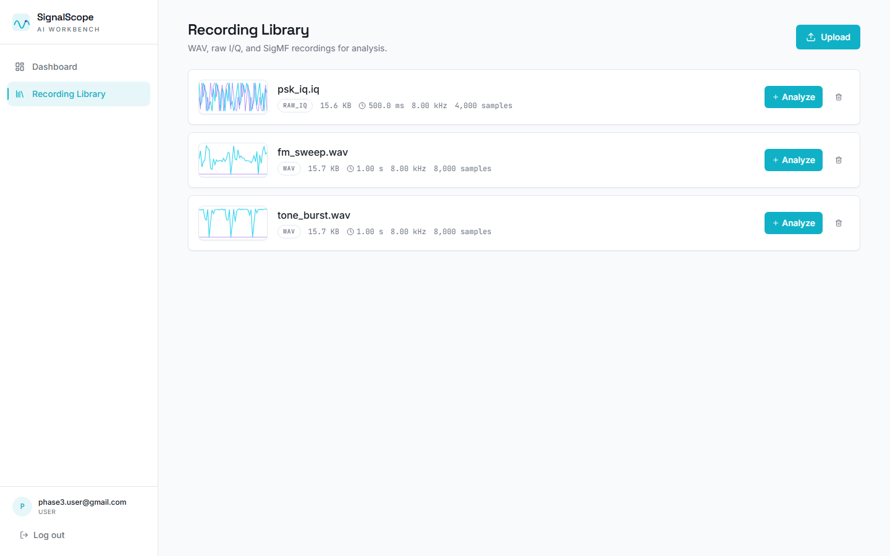
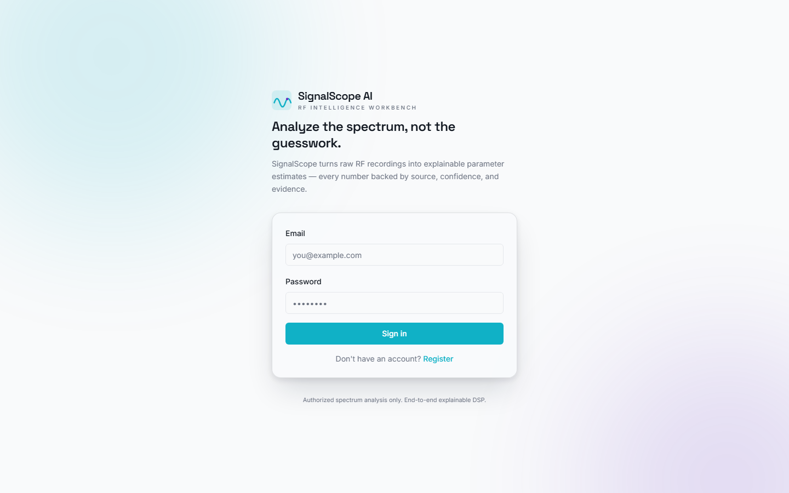
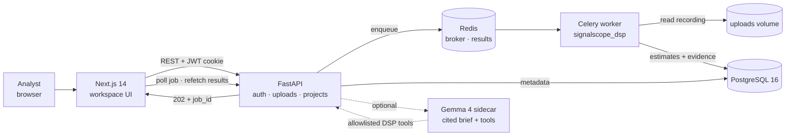

<div align="center">



# SignalScope AI

**Explainable RF signal-analysis workbench**

Turn authorized WAV, raw I/Q, and SigMF recordings into provenance-tracked estimates — from raw spectrum to demodulated bits — with every number backed by evidence.

[](./RUN.md)
[](./services/dsp-worker/pyproject.toml)
[](./LICENSE)
[](./services/api/requirements.txt)
[](./apps/web/package.json)
[](./services/api/requirements.txt)
[](./docker-compose.yml)

[Quick start](#-quick-start) · [Features](#-what-you-get) · [Architecture](#-architecture) · [Gemma 4 analyst](#-gemma-4-ai-analyst-optional) · [API](#-api-surface) · [Testing](#-testing) · [Docs](#-documentation-map)

</div>

> [!IMPORTANT]
> SignalScope is built for **authorized** spectrum analysis only. Use it on recordings you own or have explicit permission to analyze. It does not decrypt protected communications and is not a live SDR capture tool.

---

## Why SignalScope

Most signal analyzers print one number and call it truth. SignalScope treats every parameter as an **estimate with provenance**:

| | |
|---|---|
| **Explainable by default** | Every estimate carries `source`, `confidence`, `evidence`, `alternatives`, and `warnings`. |
| **Offline and private** | The full DSP pipeline runs locally. Recordings never leave your machine. |
| **Evidence drill-down** | “View proof” opens the spectrum, symbol-clock line, run-length histogram, or FEC detail behind a claim. |
| **End-to-end** | Load → spectrum → bursts → modulation → symbol rate → demod → de-interleave → FEC → bit correlation. |
| **Self-verifying** | Built-in synthetic signal generator and demo recordings exercise the pipeline without external datasets. |
| **AI that cannot invent numbers** | The optional Gemma 4 analyst reasons over DSP evidence; numeric values are backend-substituted. |

---

## What you get

| Capability | Details |
|---|---|
| **Multi-format ingestion** | WAV (mono or stereo I/Q), raw I/Q (`int8`→`float64`, interleaved / separate-I/Q / real-only), and SigMF `-meta` + `-data` pairs. Uploads are streamed, hashed, deduplicated, and capped at 200 MB. |
| **Provenance-first DSP** | Occupied bandwidth, peak/centroid frequency, spectral flatness, crest factor, zero-crossing rate, SNR, frequency drift, burst statistics, modulation hypotheses, symbol-rate candidates, and bit-level results. |
| **Interactive workspace** | Waveform and I/Q scatter with ROI selection, PSD, waterfall, burst timeline, ranked modulation/symbol-rate candidates, confidence badges, and downloadable proof JSON. |
| **Deep analysis** | Capped-window deep dive with modulation proof spectra, de-interleaving candidates (block, convolutional, diagonal, pseudo-random), selectable FEC, CRC checks, and repeated-sequence correlation. |
| **Interferometric origin** | Dual/multi-antenna raw-IQ frames can be classified as `sky`, `near_field_observatory`, or `inconclusive` from cross-spectral coherence and phase-slope delay. Optional `baseline_m` enables a far-field bearing check. |
| **FEC lab** | Hard-decision Viterbi (rate-1/2 convolutional), Reed–Solomon with erasures, LDPC belief propagation, and concatenated RS + convolutional decoding — each reporting corrected symbols, stage failures, and CRC validity. |
| **Demo signal lab** | One-click QPSK, 2-FSK, 16-QAM, BPSK burst, and 8-PSK recordings in the dashboard and recording library. |
| **Optional Gemma 4 analyst** | Cited natural-language brief, conflict/anomaly detection, allowlisted DSP tool calls, and rendered PSD/waterfall/constellation/M-th-power evidence images. AI output is always labelled `ai_hypothesis`. |
| **PWA-ready UI** | Installable Next.js app with manifest, favicons, responsive layouts, and a 375 px proof-panel bottom sheet. |

---

## Screenshots

| Dashboard | Analysis workspace |
|---|---|
|  |  |

| Recording library | Landing / auth |
|---|---|
|  |  |

> Mobile captures for every view are in [`docs/screenshots/after/`](./docs/screenshots/after). The UI design rationale is documented in [`docs/DESIGN_NOTES.md`](./docs/DESIGN_NOTES.md).

---

## Tech stack

**Frontend** · Next.js 14 · React 18 · TypeScript 5 · Tailwind CSS · shadcn/ui · TanStack Query · Zustand · Plotly.js · Vitest + Testing Library

**Backend** · FastAPI 0.115 · Pydantic v2 · SQLAlchemy 2.0 async · Alembic · Celery 5.5 · JWT httpOnly cookies · Argon2 · Redis rate limiting

**Data** · PostgreSQL 16 · Redis 7 · Docker volumes for raw recordings

**DSP** · NumPy 2.2 · SciPy 1.15 · Pillow (evidence PNGs) · Pytest

**AI (optional)** · Gemma 4 E4B via Transformers, fake offline backend, or GGUF/Ollama-class local runtime

---

## Architecture



**Request lifecycle**

1. The browser uploads a recording; the API validates it with the same DSP loaders used by the worker.
2. `POST /api/projects/{id}/estimate-parameters` returns **202 Accepted** with a job id.
3. Celery consumes the task, runs the DSP pipeline, and writes provenance rows to PostgreSQL.
4. The UI polls `/api/jobs/{id}` every 2 s and refetches estimates when the job completes.
5. Optional: `POST /api/projects/{id}/insights` queues a Gemma 4 brief over the same evidence.

The complete system design, sequence diagrams, and deployment topology live in [`ARCHITECTURE.md`](./ARCHITECTURE.md) and [`detailedarch.md`](./detailedarch.md).

---

## Quick start

### Prerequisites

- **Docker Desktop** + Docker Compose
- **Node.js 20+** only for host-side frontend development
- **Python 3.11–3.13** only for native backend/tests (pinned NumPy/SciPy have no Python 3.14 wheels)

### 1. Clone and configure

```bash
git clone https://github.com/Manas-Dikshit/SignalScope.git signalscope
cd signalscope

cp .env.example .env
cp apps/web/.env.example apps/web/.env.local

# Replace the placeholder with a real secret
openssl rand -hex 32
```

Set that value as `SECRET_KEY` in `.env`.

### 2. Launch the stack

```bash
# Development: API/worker hot-reload
docker compose -f docker-compose.yml -f docker-compose.dev.yml up --build
```

For a detached production-style run:

```bash
docker compose up --build -d
docker compose ps
```

### 3. Open it

| Service | URL |
|---|---|
| Web app | http://localhost:3000 |
| API | http://localhost:8000 |
| Swagger UI | http://localhost:8000/docs |
| PostgreSQL | `localhost:5432` (`signalscope` / `signalscope`) |
| Redis | `localhost:6379` |

Register an account, then either upload a recording or click a **demo signal** on the dashboard.

> The dev overlay must be passed **both** files. It enables API/worker hot-reload; run the frontend separately with `npm run dev` if you want HMR on the host.

### 4. Try a demo signal

Five synthetic recordings are built in and load instantly from the **Demo signals** section:

| Demo | Modulation | Sample rate | Symbol rate |
|---|---|---:|---:|
| QPSK carrier | QPSK | 48 kHz | 2400 baud |
| Binary FSK | 2-FSK | 48 kHz | 1200 baud |
| 16-QAM grid | 16-QAM | 48 kHz | 2400 baud |
| BPSK bursts | BPSK | 48 kHz | 2400 baud |
| 8-PSK circular | 8-PSK | 48 kHz | 2400 baud |

Sample files also live in [`samples/`](./samples) and can be regenerated with `python scripts/generate_samples.py`.

---

## Gemma 4 AI analyst (optional)

The AI sidecar is **off by default**. The deterministic DSP/API/UI stack works exactly the same with `AI_ENABLED=false`.

```bash
# Copy .env.example -> .env, then enable AI
AI_ENABLED=true
AI_BACKEND=fake            # fake = no model download, deterministic
INTERNAL_API_TOKEN=change-me

# Start the core stack plus the AI service
docker compose --profile ai up --build
```

To use a real local model:

```bash
AI_BACKEND=transformers
AI_MODEL=google/gemma-4-E4B-it
AI_INSTALL_TRANSFORMERS=1
docker compose --profile ai up --build
```

**What the analyst does**

- Reads a structured `EvidenceBundle` built from stored DSP estimates.
- Reasons over rendered PSD, waterfall, constellation, and M-th-power PNGs — never raw I/Q.
- Calls only allowlisted DSP tools: `get_project_evidence`, `run_deep_analysis`, `try_demodulation`, `try_fec`.
- Reports conflicts, anomalies, unknowns, limitations, and recommended next actions.
- Produces a cited brief; every number is substituted by the backend from provenance.

**Guardrails**

- AI output is stored and displayed as `source = ai_hypothesis`.
- Strict JSON schema validation, evidence-reference validation, numeric guard, allowlisted tool dispatch.
- Bounded tool loop (`AI_MAX_TOOL_STEPS`, default 6) with per-call timeouts.
- On failure, DSP results are preserved and the UI shows an explicit error/fallback.
- Model: **Gemma 4 E4B IT** (`google/gemma-4-E4B-it`), Apache-2.0. Runs locally.

See [`docs/GEMMA4_IMPLEMENTATION_PLAN.md`](./docs/GEMMA4_IMPLEMENTATION_PLAN.md) and [`services/ai/README.md`](./services/ai/README.md) for the full contract, model options, and GPU notes.

---

## Provenance model

Every estimate is an object, never a bare number:

```json
{
  "name": "symbol_rate",
  "value": 250000.0,
  "unit": "symbols/s",
  "source": "estimated",
  "confidence": 0.93,
  "evidence": [
    "dominant spectral peak at 250.0 kHz (±2.5 kHz) in the cyclostationary profile",
    "agrees within 1.2% of candidate from zero-crossing analysis"
  ],
  "alternatives": [
    { "value": 256000.0, "evidence": ["second harmonic candidate"] }
  ],
  "warnings": []
}
```

**Sources** are explicit: `metadata`, `user_supplied`, `measured`, `estimated`, `hypothesis`, `ai_hypothesis`, `unknown`. The UI colour-codes confidence and lets you expand the evidence behind every claim.

**Pipeline stages** — load → condition → PSD/waterfall → spectral features → burst detection → modulation classification → symbol-rate estimation → interferometric origin → demodulation → de-interleaving → FEC decoding → bit correlation → provenance assembly.

---

## API surface

Full interactive documentation is available at **`/docs`** (Swagger UI).

| Area | Endpoint | Method |
|---|---|---|
| Auth | `/api/auth/register` · `/api/auth/login` · `/api/auth/logout` · `/api/auth/me` | POST · POST · POST · GET |
| Uploads | `/api/recordings/upload` | POST |
| Recordings | `/api/recordings` · `/{id}` · `/{id}/metadata` · `/{id}/preview` | GET · GET/PATCH/DELETE · GET/PATCH · GET |
| Demo signals | `/api/recordings/demos` · `/api/recordings/load-demo` | GET · POST |
| Projects | `/api/projects` · `/{id}` | POST/GET · GET/PATCH/DELETE |
| Analysis | `/api/projects/{id}/estimate-parameters` | POST → **202** |
| Results | `/api/projects/{id}/parameters` · `/{id}/analysis` · `/{id}/segments` | GET |
| Bursts | `/api/projects/{id}/detect-bursts` | POST |
| AI insights | `/api/projects/{id}/insights` | POST (queue) · GET (latest) |
| Jobs | `/api/jobs/{id}` | GET |
| Dashboard | `/api/dashboard/stats` | GET |
| Internal tools | `/internal/dsp-tools/{tool_name}` | POST + `X-Internal-Token` |
| Health | `/health` | GET |

All project, recording, and insight routes enforce per-user ownership. Uploads are validated for format and size; the private DSP tool route is disabled when `INTERNAL_API_TOKEN` is empty.

---

## Testing

All four suites:

| Suite | Command | Tests |
|---|---|---:|
| DSP core | `cd services/dsp-worker && python -m pytest tests/ -q` | **69** |
| API | `cd services/api && python -m pytest tests/ -q` | **51** |
| AI sidecar | `cd services/ai && python -m pytest tests/ -q` | **19** |
| Frontend | `cd apps/web && npm test` | **26** |

Coverage includes WAV/raw-IQ/SigMF loading, bounded windows, dual-antenna frames, interferometric origin verdicts, modulation/demodulation BER round trips, symbol-rate estimation, de-interleaving, convolutional/Reed–Solomon/LDPC/concatenated FEC, CRC, proof spectra, kHz–GHz band coverage, auth, uploads, projects, jobs, cross-user isolation, demo samples, evidence images, AI validation/tool-loop behavior, provenance badges, and formatting utilities.

Run everything from Docker:

```bash
make test
```

---

## Project structure

```text
SignalScope/
├── apps/web/                  # Next.js 14 dashboard, library, analysis workspace
├── services/
│   ├── api/                   # FastAPI routers, Celery tasks, Alembic migrations
│   ├── dsp-worker/            # signalscope_dsp: loaders, DSP stages, FEC, provenance
│   └── ai/                    # Optional Gemma 4 sidecar (FastAPI)
├── docker/                    # Dockerfiles for web, api, worker, ai
├── docs/                      # Setup, architecture, design, traceability, Gemma plan
├── samples/                   # Committed test/demo recordings
├── scripts/                   # Sample generator, smoke test, AI pipeline verification
├── streamlit_prototype/       # Lean standalone DSP/UI prototype
├── docker-compose.yml
├── docker-compose.dev.yml
└── Makefile
```

---

## Scope and limitations

**Intentionally out of scope**

- No live RF capture or SDR streaming.
- No geolocation or direction finding. Interferometric origin answers only *sky vs local/inconclusive*; a bearing needs a user-supplied baseline and remains an estimate.
- No decryption of protected communications — authorized recordings only.
- Demodulators sample symbol centers directly; no closed-loop Costas/PLL or Gardner/M&M timing recovery yet.
- FEC defaults to rate-1/2 convolutional/Viterbi (hard decision). Reed–Solomon, LDPC, and concatenated codes are selectable in deep analysis; soft-decision LLR decoding is future work.
- Interferometric delay is resolvable only within half the analyzed band; wider delays can alias.
- API tests run against SQLite for speed; the Postgres path is exercised by Docker deployment.
- The AI sidecar is an analyst assistant, not an authority. It never replaces deterministic DSP and is disabled by default.

---

## Roadmap

- [x] Provenance-tracked DSP pipeline and evidence drill-down
- [x] WAV / raw-IQ / SigMF ingestion with bounded-window loading
- [x] Convolutional, Reed–Solomon, LDPC, and concatenated FEC
- [x] Burst detection, de-interleaving candidates, bit correlation
- [x] Interferometric origin discrimination from dual-antenna IQ
- [x] Demo signal library and PWA-ready UI
- [x] Gemma 4 cited brief, agent tool loop, and multimodal evidence images
- [ ] Rare-signal gallery / fingerprint similarity search
- [ ] QLoRA fine-tuning on synthetic RF evidence pairs
- [ ] Closed-loop carrier and timing recovery (Costas / PLL / Gardner)
- [ ] Neural-network modulation classifier
- [ ] Hardened multi-user deployment (key rotation, external object storage)
- [ ] GNU Radio integration

---

## Documentation map

| Document | What it covers |
|---|---|
| [`RUN.md`](./RUN.md) | Three ways to run the stack, smoke test, troubleshooting |
| [`ARCHITECTURE.md`](./ARCHITECTURE.md) | System design, layers, sequence flow, deployment topology |
| [`detailedarch.md`](./detailedarch.md) | Low-level service, port, data-store, and DSP-stage view |
| [`docs/LOCAL_SETUP.md`](./docs/LOCAL_SETUP.md) | Local Docker/native setup and configuration reference |
| [`docs/REQUIREMENTS_TRACEABILITY.md`](./docs/REQUIREMENTS_TRACEABILITY.md) | Requirement → implementation → test mapping |
| [`docs/GEMMA4_IMPLEMENTATION_PLAN.md`](./docs/GEMMA4_IMPLEMENTATION_PLAN.md) | Gemma 4 phases, contracts, guardrails, demo script |
| [`docs/DESIGN_NOTES.md`](./docs/DESIGN_NOTES.md) | UI visual-depth rationale and deferred ML note |
| [`CONTRIBUTING.md`](./CONTRIBUTING.md) | Layout, conventions, test expectations, PR checklist |
| [`REFERENCES.md`](./REFERENCES.md) | Formats, DSP, FEC, and AI references |

---

## License

MIT — see [`LICENSE`](./LICENSE).

SignalScope AI is intended for **authorized** spectrum analysis and research. The authors assume no responsibility for misuse of the DSP capabilities. Gemma 4 model weights are distributed under the Apache-2.0 license by Google.

<div align="center">

**Every number is an estimate. Every estimate has a source, a confidence, and evidence you can read.**

</div>
