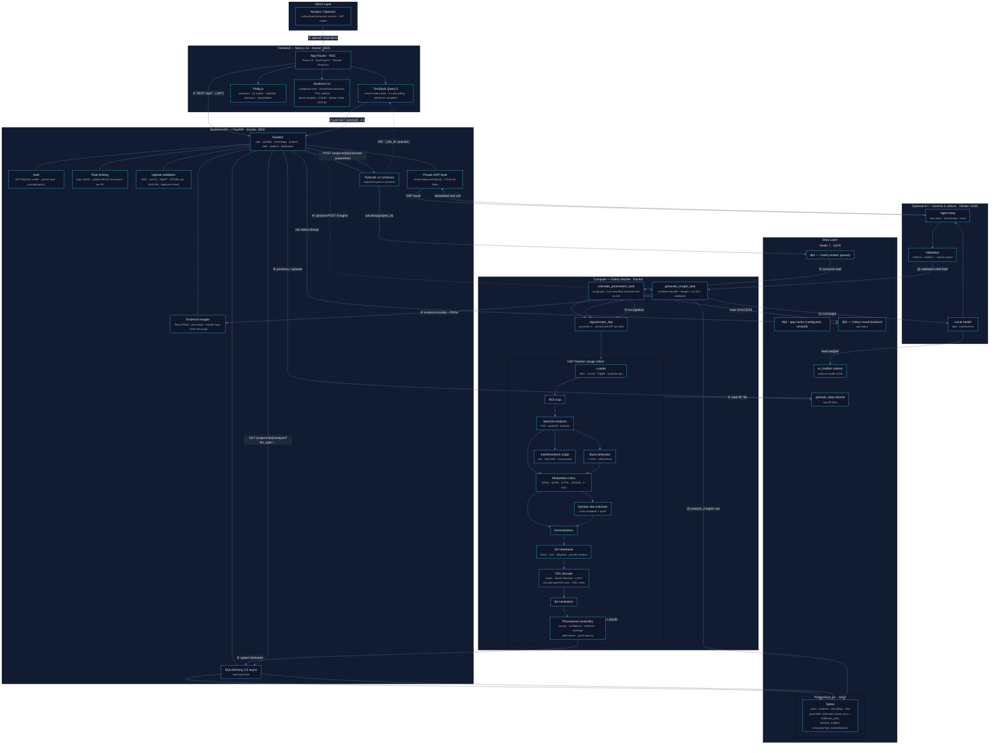
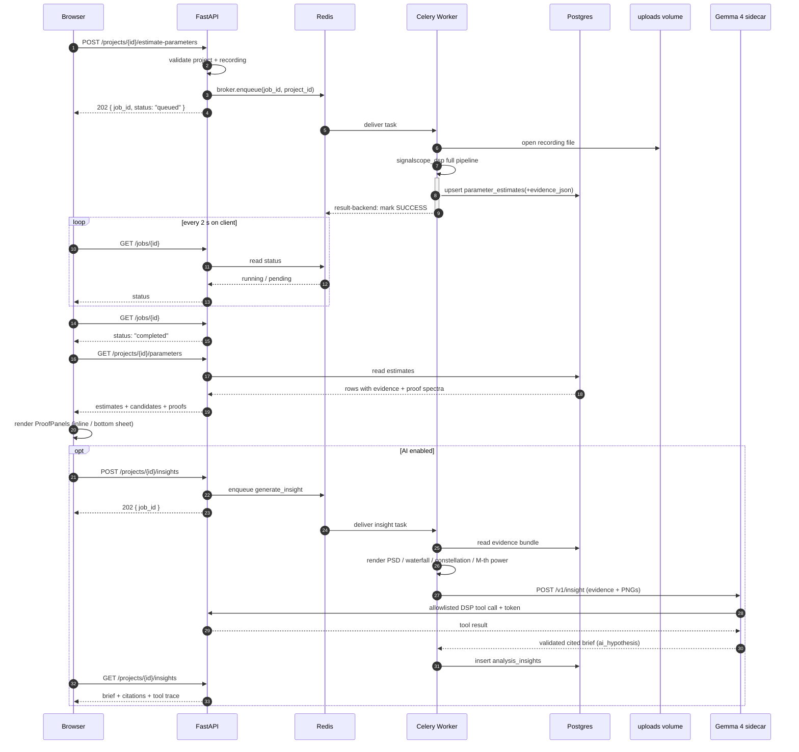

<div align="center">

# SignalScope AI — Detailed Technical Architecture

**A low-level view: every service, port, data store, message hop, DSP stage, and optional AI hop.**

</div>

---

## Service topology

| Container | Tech | Port | Role |
|-----------|------|------|------|
| `web` | Next.js 14 · React 18 · TypeScript 5 · Tailwind · shadcn/ui | `3000` | SPA + SSR shell, TanStack Query polling, Plotly visualizations, web manifest |
| `api` | FastAPI 0.115 · Pydantic v2 · SQLAlchemy 2.0 async | `8000` | REST gateway: auth, uploads, recordings, projects, jobs, insights, dashboard |
| `worker` | Celery 5.5 · `signalscope_dsp` (editable) | — | Background executor for DSP and insight tasks |
| `ai` *(optional)* | FastAPI · Gemma 4 | `8100` | Cited analyst brief, allowlisted DSP tools, evidence-image validation |
| `postgres` | PostgreSQL 16 | `5432` | Primary relational store |
| `redis` | Redis 7 | `6379` | db0 app cache (configured, unused) · db1 Celery broker · db2 result backend |
| `uploads_data` | Docker volume | — | Raw RF recordings on disk (never in memory) |
| `ai_models` | Docker volume | — | Optional local Gemma 4 weights / HF cache |

---

## Detailed system diagram



---

## Async job lifecycle



---

## Stage contracts

### Loader layer

- WAV: mono or stereo I/Q; stereo modes `left_is_i_right_is_q`, `left_only`, `right_only`, `mono_mix`.
- Raw I/Q: dtype selection, endianness, `interleaved` / `separate_iq` / `real_only`, optional `sample_rate_hz`, `center_frequency_hz`, and `channels` for simultaneous antenna frames.
- SigMF: paired `-meta` + `-data` files, including standard metadata fields.
- Bounded windows (`sample_offset`, `max_samples`) keep interactive endpoints from loading multi-hundred-MB files.

### Estimate contract

```json
{
  "name": "modulation",
  "value": "QPSK",
  "unit": null,
  "source": "hypothesis",
  "confidence": 0.64,
  "evidence": ["4th-power spectral peakiness=0.88"],
  "alternatives": [
    { "value": "16-QAM", "confidence": 0.41, "evidence": ["amplitude-ring structure"] }
  ],
  "warnings": ["Modulation classification is a hypothesis."]
}
```

### Proof payloads

| Proof | Attached to | Produced by |
|---|---|---|
| M-th power spectra `order_2/4/8` | Modulation hypothesis | `modulation/classifier.py::mth_power_spectrum` |
| Symbol-clock spectrum | Symbol-rate candidates | `modulation/symbol_rate.py::symbol_clock_spectrum` |
| Run-length histogram + score | De-interleave candidates | `interleaving/block.py` |
| FEC detail (corrected, erasures, CRC, stage failure) | FEC result | `fec/` result dataclasses |
| Interferometric coherence / delay / bearing | Origin verdict | `interferometry/interferometric.py` |

---

## AI integration contract

| Piece | Details |
|---|---|
| API contract | `POST /v1/insight` with `project_id`, `prompt_version`, `evidence`, `images` |
| Response | Strict JSON: summary template, hypothesis, conflicts, anomalies, recommendations, unknowns, limitations, citations, tool trace |
| Numeric honesty | Model writes `{{estimate:name}}` placeholders; backend substitutes provenance values and rejects unsupported numbers |
| Tool allowlist | `get_project_evidence`, `run_deep_analysis`, `try_demodulation`, `try_fec` |
| Tool route | Private `/internal/dsp-tools/{tool_name}` with `X-Internal-Token` |
| Bounds | `AI_MAX_TOOL_STEPS`, `AI_TOOL_TIMEOUT_SECONDS`, `AI_TIMEOUT_SECONDS` |
| Images | PSD, waterfall, constellation, M-th power; PNG data URIs only; per-image and bundle caps |
| Failure behavior | Retry once with validation error; then deterministic fallback; DSP results preserved |
| Provenance | `Source.AI_HYPOTHESIS`; UI badge **AI-generated — verify evidence** |

---

## Local development topology

| Container | Image build | Exposed port | Role |
|-----------|-------------|--------------|------|
| `web` | `docker/Dockerfile.web` | `3000` | Next.js standalone server |
| `api` | `docker/Dockerfile.api` | `8000` | FastAPI + `/docs` |
| `worker` | `docker/Dockerfile.worker` | — | Celery DSP/insight executor |
| `ai` | `services/ai/Dockerfile` | `8100` | Optional Gemma 4 sidecar (`--profile ai`) |
| `postgres` | `postgres:16-alpine` | `5432` | Primary datastore |
| `redis` | `redis:7-alpine` | `6379` | Broker + backend + cache |

> The dev overlay (`docker-compose.dev.yml`) adds hot-reload for API and worker. Run the web dev server on the host for frontend HMR. The AI service is absent from the default stack and can be enabled with `docker compose --profile ai up`.

---

<div align="center">

**_"Every number is an estimate. Every estimate has a source, a confidence, and evidence you can read."_**

[← Back to README](./README.md)

</div>
