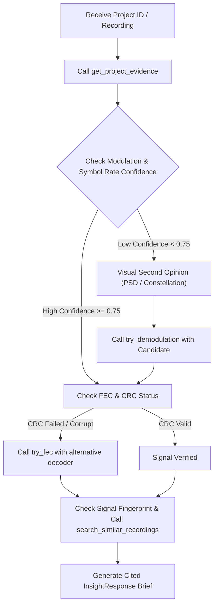

# Signal Triage Agent Skill

The `signal-triage` skill provides a structured, provenance-preserving protocol for autonomous coding and reasoning agents to analyze authorized radio frequency (RF) recordings using the **SignalScope AI** workbench.

## 1. Core Operating Principles

When triaging or analyzing RF signals with this skill, you MUST strictly adhere to the following invariants:

1. **Strict Numeric Honesty**:
   - NEVER calculate, invent, or output authoritative numeric values (e.g. carrier frequency, symbol rate, SNR, bandwidth) from model memory or intuition.
   - All quantitative figures must originate from deterministic DSP output.
   - When drafting insight summaries, use placeholder templates: `{{estimate:symbol_rate}}`, `{{estimate:snr_db}}`, `{{evidence:modulation_warning}}`. The backend substitutes the ground truth from database provenance.
2. **Provenance Accountability**:
   - Every claim, hypothesis, conflict, or anomaly must explicitly cite at least one `evidence_ref` present in the `EvidenceBundle`.
   - All AI-generated findings must be categorized under `source: "ai_hypothesis"`. Never claim a result is `measured` or `metadata`.
3. **No Raw I/Q Ingestion**:
   - Do NOT feed raw complex I/Q sample arrays into LLMs.
   - Use pre-rendered visual evidence (PSD, spectrogram, constellation scatter, M-th power spectra) and scalar feature vectors.
4. **Tool Safety & Confinement**:
   - Only invoke allowlisted DSP tools from the registry below.
   - Never execute arbitrary shell commands, code generation, or unauthenticated network requests as part of signal triage.

---

## 2. Allowlisted DSP Tool Registry

| Tool Name | Parameters | Purpose | Returns |
|---|---|---|---|
| `get_project_evidence` | None | Fetches the full `EvidenceBundle` for the current project. | Stored estimates, recording metadata, SNR, bandwidth, candidate modulations. |
| `run_deep_analysis` | `fec_type` ("convolutional", "reed_solomon", "ldpc", "concatenated") | Runs synchronous ROI deep analysis with the specified FEC decoder. | Constellation symbols, demodulated bits, de-interleaving candidates, FEC convergence report. |
| `try_demodulation` | `modulation` ("BPSK", "QPSK", "8-PSK", "16-QAM", "64-QAM", "2-FSK", "4-FSK"), optional `samples_per_symbol` (2-64) | Evaluates a specific modulation scheme against the signal. | Bit preview, soft-decision margin proxy, symbol correlation. |
| `try_fec` | `fec_type` ("convolutional", "reed_solomon", "ldpc", "concatenated") | Runs a specific FEC decoder on the demodulated symbol stream. | CRC validation verdict, corrected symbol counts, stage failures. |
| `search_similar_recordings`| `limit` (1-20, default 5) | Performs kNN search over owner-scoped 22-dimensional spectral fingerprints. | Cosine distances, similarity scores, nearest project metadata, and `rare_signal` flag. |

---

## 3. Recommended Triage Workflow



### Step 1: Ingest Evidence Bundle
Retrieve recording metadata and parameter estimates using `get_project_evidence`. Verify:
- Sample rate ($f_s$) and duration.
- Occupied bandwidth (99% power containment).
- Estimated SNR and frequency drift.
- Top candidate modulations and their relative confidence.

### Step 2: Cross-Modal Visual Inspection
Cross-reference the scalar estimates with the rendered evidence images:
- **PSD**: Check for symmetric side-lobes, spectral flatness, and carrier leakage.
- **Waterfall**: Check for burstiness, pulse repetition interval (PRI), or frequency hopping.
- **Constellation Scatter**: Check for clustering (e.g. 4 distinct quadrants for QPSK, amplitude rings for 16-QAM).
- **M-th Power Spectra**: Check for discrete spectral lines at $2 \times f_c$ (BPSK), $4 \times f_c$ (QPSK), or symbol-clock harmonics.

### Step 3: Conflict & Anomaly Triage
Identify potential contradictions:
- *Conflict Example:* The classifier reports `16-QAM` (confidence 0.62), but the constellation exhibits constant envelope (indicating PSK/FSK) or the SNR is too low ($< 12\text{ dB}$) for reliable 16-QAM recovery.
- *Action:* Call `try_demodulation` with `modulation: "QPSK"`.

### Step 4: Coding & FEC Verification
If demodulation succeeds but FEC fails CRC:
- Check `stage_failed` in the FEC evidence.
- If convolutional Viterbi fails, invoke `try_fec` with `fec_type: "ldpc"` or `"reed_solomon"`.

### Step 5: Novelty & Rarity Assessment
If the signal possesses a spectral fingerprint:
- Invoke `search_similar_recordings` with `limit: 5`.
- If the nearest cosine distance exceeds the threshold (default 0.35), flag the signal as a `rare_signal` candidate.
- *Caution:* Never declare certainty or unique identification; explain why its spectral features differ from known library samples.

### Step 6: Emit Structured Brief
Format output strictly adhering to the `InsightResponse` schema.

---

## 4. Output Contract (`InsightResponse`)

Agents must produce JSON conforming to this specification:

```json
{
  "summary_template": "Signal is characterized as {{estimate:modulation}} at {{estimate:symbol_rate}} with SNR {{estimate:snr_db}}. {{evidence:modulation_warning}}.",
  "hypothesis": {
    "label": "QPSK",
    "agreement_with_dsp": true,
    "confidence_note": "Constellation quadrants align with 4th-power spectral peak.",
    "evidence_refs": ["modulation", "symbol_rate", "constellation"]
  },
  "conflicts": [
    {
      "between": ["modulation", "snr_db"],
      "explanation": "Marginal SNR increases error vector magnitude in outer symbols.",
      "evidence_refs": ["modulation", "snr_db"]
    }
  ],
  "anomalies": [],
  "recommended_actions": [
    {
      "action": "try_fec",
      "args": { "fec_type": "ldpc" },
      "why": "Convolutional CRC failed; test LDPC belief propagation.",
      "evidence_refs": ["fec"]
    }
  ],
  "unknowns": [
    "Precise packet framing preamble is unconfirmed."
  ],
  "limitations": [
    "AI hypothesis generated offline from bounded window evidence."
  ],
  "citations": {
    "modulation": "parameter_estimates.modulation",
    "symbol_rate": "parameter_estimates.symbol_rate",
    "snr_db": "parameter_estimates.snr_db"
  },
  "tool_trace": []
}
```

---

## 5. Safety & Regulatory Boundaries

- **Authorized Signals Only**: This skill is strictly designed for analyzing authorized, laboratory, or synthetic captures.
- **Zero Decryption**: Do not attempt to reverse cryptographic ciphers or bypass access control systems.
- **Physical Safety**: The interferometric classification tool distinguishes local observatory interference from sky sources; it is not a tactical direction-finding or geolocation system.
